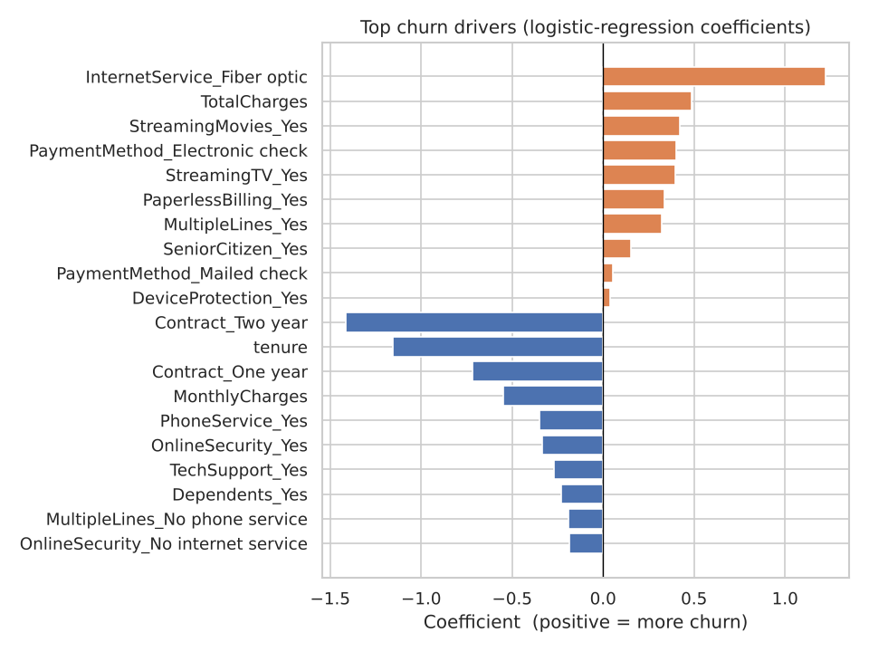

# Telco Customer Churn

A churn analysis I put together on the Telco customer dataset: some exploratory
work to understand who leaves, then a logistic regression to predict churn and
see which factors actually drive it.

Dataset is the public IBM "Telco Customer Churn" set (7,043 customers, 20
fields covering demographics, account info and the services each customer has).
You can grab it from [Kaggle](https://www.kaggle.com/datasets/blastchar/telco-customer-churn).

## Why

Keeping a customer is a lot cheaper than winning a new one, so it's worth
knowing (a) who's likely to leave and (b) what's pushing them out, so retention
effort goes to the right people.

## Results

Logistic regression, 80/20 train-test split, class weighting to deal with the
churn imbalance (only ~27% of customers churn). On the held-out test set
(1,409 customers):

| Metric | Score |
|--------|-------|
| ROC-AUC | 0.842 |
| Recall (churners) | 0.783 |
| Precision (churners) | 0.504 |
| F1 (churners) | 0.614 |
| Accuracy | 0.738 |

I tuned it to catch churners rather than chase raw accuracy, since in a
retention setting missing someone who's about to leave costs more than a false
alarm. It picks up about 78% of the customers who actually churned.

## What drives churn

Pulled straight from the model coefficients (odds ratios in brackets):

Pushes churn up:
- Fiber-optic internet (3.4x odds)
- Higher total charges
- Streaming TV / movies add-ons
- Paying by electronic check

Pulls churn down:
- Two-year contract (0.24x odds) and one-year contract
- Longer tenure
- Having phone service

Short version: month-to-month fiber customers paying by electronic check are
the group most likely to leave, and getting people onto longer contracts is the
biggest lever for keeping them.



## Running it

```bash
pip install -r requirements.txt
python src/churn_analysis.py
```

That cleans the data, writes the charts to `outputs/figures/`, saves the metrics
to `outputs/metrics.json` and the ranked drivers to `outputs/churn_drivers.csv`.
The notebook in `notebooks/` walks through the same thing step by step if you'd
rather read it that way.

## Layout

```
data/      raw dataset (7,043 rows)
src/       churn_analysis.py  - the full pipeline
notebooks/ churn_analysis.ipynb  - annotated walkthrough
outputs/   figures, metrics.json, churn_drivers.csv
```

## How it's built

Cleaning: `TotalCharges` comes in as text because brand-new customers (tenure 0)
have it blank, so I convert it to a number and set those blanks to 0, drop
`customerID`, and turn the `Churn` column into 0/1.

Features: one-hot encode the categorical columns (dropping the first level to
avoid collinearity) and standard-scale the three numeric ones (tenure, monthly
charges, total charges).

Model: plain logistic regression with `class_weight="balanced"`, fixed random
seed so the numbers reproduce. I went with logistic regression on purpose — it's
easy to read the coefficients and say *why* a customer is at risk, which matters
more here than squeezing out an extra point of accuracy.

---

Hitesh Bharambe · [GitHub](https://github.com/HiteshBharambe99) · [LinkedIn](https://linkedin.com/in/hitesh-bharambe)
